# Pruebas – Catálogo de productos Papelería Campus

**Fecha de ejecución:** 15/10/2026

**Entorno:**

| Elemento | Valor |
|---|---|
| Sistema operativo | Windows 11 |
| JDK | Temurin 21.0.10 |
| JavaFX | 21.0.6 |
| Base de datos | PostgreSQL 18.4, base `papeleria_campus` |
| Datos iniciales | Los 12 productos de `Datos.sql` |

**Método:** pruebas funcionales de caja negra sobre la aplicación real, conectada a la base real. Las acciones de la interfaz (escribir en los campos, elegir filtros y presionar botones) se ejecutaron con un guion que maneja la ventana de la aplicación. Para cada caso se registró el mensaje mostrado y el contenido de la tabla, y las capturas son screenshots de la pantalla. La prueba BD01 se ejecutó manualmente en pgAdmin.

Los productos de prueba (`Z001` y `Z002`) se eliminaron al final, así que la base quedó otra vez con sus 12 productos.

## Resumen

| Grupo | Casos | Aprobados | Fallidos |
|---|---|---|---|
| Listado, búsqueda y filtros (B) | 9 | 9 | 0 |
| Validaciones del formulario (V) | 13 | 13 | 0 |
| Ciclo CRUD (C) | 5 | 5 | 0 |
| Errores (E) | 1 | 1 | 0 |
| Restricciones de la base de datos (BD) | 1 | 1 | 0 |
| **Total** | **29** | **29** | **0** |

## Matriz de resultados

### Listado, búsqueda y filtros

| ID | Caso | Entrada / pasos | Resultado esperado | Resultado obtenido | Estado | Evidencia |
|---|---|---|---|---|---|---|
| B01 | Listado inicial | Abrir la aplicación | 12 productos ordenados por código ascendente (A001 … T004) | `Registros: 12`. Orden: A001–A004, P001–P004, T001–T004 | Aprobado | [01](evidencias/01_listado_inicial.png) |
| B02 | Texto parcial | Texto `cuader` → Buscar | P001 y P002 | 2 registros: P001 Cuaderno universitario, P002 Cuaderno cuadriculado | Aprobado | — |
| B03 | Sin distinguir mayúsculas | Texto `usb` → Buscar | T001 y T003 (los nombres tienen "USB") | 2 registros: T001 Memoria USB 32 GB, T003 Teclado USB | Aprobado | [02](evidencias/02_busqueda_texto_parcial.png) |
| B04 | Filtro por categoría | Categoría `Accesorios` → Buscar | A001–A004 | 4 registros: A001, A002, A003, A004 | Aprobado | — |
| B05 | Solo con existencias | Marcar "Solo con existencias" → Buscar | 9 productos; se excluyen A003, P004 y T004 (stock 0) | 9 registros, sin A003, P004 ni T004 | Aprobado | — |
| B06 | **Filtro combinado** (2 filtros) | Categoría `Tecnología` + "Solo con existencias" → Buscar | T001, T002 y T003; se excluye T004 (stock 0) | 3 registros: T001, T002, T003 | Aprobado | [03](evidencias/03_filtro_combinado_categoria_existencias.png) |
| B07 | **Filtro combinado** (3 filtros) | Texto `e` + categoría `Papelería` + "Solo con existencias" → Buscar | P001, P002 y P003; se excluye P004 (stock 0) | 3 registros: P001, P002, P003 | Aprobado | [04](evidencias/04_filtro_combinado_texto_categoria_existencias.png) |
| B08 | Sin coincidencias | Texto `zzz` → Buscar | Aviso "Sin coincidencias" y tabla vacía | Alerta "No existen productos que coincidan con los filtros aplicados.", `Registros: 0` | Aprobado | [05](evidencias/05_busqueda_sin_coincidencias.png) |
| B09 | Limpiar filtros | Con filtros activos → Limpiar filtros | Texto vacío, categoría `Todas`, casilla desmarcada y 12 productos | Filtros reiniciados, `Registros: 12` | Aprobado | — |

### Validaciones del formulario

Salvo que se indique otra cosa, se usó como base un formulario válido (código `V001`, nombre `Producto válido`, categoría `Papelería`, precio `10.00`, stock `1`) en el que se cambió un solo campo, y luego se presionó **Guardar**.

| ID | Caso | Entrada | Resultado esperado | Resultado obtenido | Estado | Evidencia |
|---|---|---|---|---|---|---|
| V01 | Código vacío | Código `""` | Rechazo: "Código inválido" | "Código inválido: El código debe tener de 1 a 10 caracteres…" | Aprobado | [06](evidencias/06_validacion_codigo_vacio.png) |
| V02 | Código demasiado largo | Código `ABCDEFGHIJK` (11 caracteres) | Rechazo: "Código inválido" | "Código inválido: El código debe tener de 1 a 10 caracteres…" | Aprobado | — |
| V03 | Nombre corto | Nombre `AB` | Rechazo: "Nombre inválido" | "Nombre inválido: El nombre debe tener de 3 a 80 caracteres…" | Aprobado | [07](evidencias/07_validacion_nombre_corto.png) |
| V04 | Sin categoría | Categoría sin seleccionar | Rechazo: "Categoría inválida" | "Categoría inválida: Seleccione una categoría: Papelería, Tecnología o Accesorios." | Aprobado | — |
| V05 | Precio no numérico | Precio `abc` | Rechazo: "Precio inválido" | "Precio inválido: El precio debe ser un número. Use punto como separador decimal (ej. 65.00)." | Aprobado | [08](evidencias/08_validacion_precio_no_numerico.png) |
| V06 | Precio cero | Precio `0` | Rechazo: el precio debe ser mayor que 0 | "Precio inválido: El precio debe ser mayor que 0." | Aprobado | — |
| V07 | Precio con 3 decimales | Precio `10.555` | Rechazo: máximo 2 decimales | "Precio inválido: El precio admite como máximo 2 decimales." | Aprobado | — |
| V08 | Stock negativo | Stock `-1` | Rechazo: "Stock inválido" | "Stock inválido: El stock no puede ser negativo." | Aprobado | — |
| V09 | Stock decimal | Stock `2.5` | Rechazo: el stock debe ser entero | "Stock inválido: El stock debe ser un número entero entre 0 y 2147483647." | Aprobado | [09](evidencias/09_validacion_stock_decimal.png) |
| V10 | Código duplicado | Código `p001` (en minúsculas) | Se normaliza a `P001` y se rechaza porque ya existe | "Código duplicado: El código P001 ya pertenece a otro producto." | Aprobado | [10](evidencias/10_validacion_codigo_duplicado.png) |
| V11 | Actualizar sin selección | Sin fila seleccionada → Actualizar | Aviso "Producto no seleccionado" | "Debe seleccionar un producto de la tabla antes de actualizar." | Aprobado | [11](evidencias/11_validacion_actualizar_sin_seleccion.png) |
| V12 | Eliminar sin selección | Sin fila seleccionada → Eliminar | Aviso "Producto no seleccionado" | "Debe seleccionar un producto de la tabla antes de eliminar." | Aprobado | — |
| V13 | Ningún dato inválido llega a la base | Recargar el listado después de V01–V12 | Siguen 12 productos | `Registros: 12`, sin registros nuevos | Aprobado | — |

### Ciclo CRUD

| ID | Caso | Entrada / pasos | Resultado esperado | Resultado obtenido | Estado | Evidencia |
|---|---|---|---|---|---|---|
| C01 | **Crear** | Código `␣␣z001␣`, nombre `Producto de prueba CRUD`, `Tecnología`, precio `99.9`, stock `5` → Guardar | "Registro guardado", formulario limpio, 13 productos. El código se guarda como `Z001` y el precio como `99.90` | Alerta "El producto fue registrado correctamente.", formulario limpio, `Registros: 13`, fila `14 · Z001 · Producto de prueba CRUD · Tecnología · 99.90 · 5` | Aprobado | [12](evidencias/12_crud_1_formulario_nuevo.png), [13](evidencias/13_crud_2_registro_guardado.png) |
| C02 | **Consultar** | Texto `z001` → Buscar | Solo aparece Z001 | `Registros: 1`, Z001 | Aprobado | [14](evidencias/14_crud_3_consulta_registro_creado.png) |
| C03 | **Actualizar** | Seleccionar Z001 (el formulario se carga con ID 14). Nombre `Producto de prueba CRUD editado`, precio `120.50`, stock `10` → Actualizar | "Registro actualizado" y la tabla muestra los cambios | Alerta "El producto fue actualizado correctamente.", fila `14 · Z001 · Producto de prueba CRUD editado · Tecnología · 120.50 · 10` | Aprobado | [15](evidencias/15_crud_4_formulario_edicion.png), [16](evidencias/16_crud_5_registro_actualizado.png), [17](evidencias/17_crud_6_consulta_registro_actualizado.png) |
| C04 | **Eliminar** (confirmando) | Seleccionar Z001 → Eliminar → Aceptar | Se pide confirmación, se elimina el producto y vuelven a quedar 12 | Confirmación "¿Desea eliminar el producto Z001 - Producto de prueba CRUD editado?", alerta "El producto fue eliminado correctamente.", listado con `Registros: 12` | Aprobado | [18](evidencias/18_crud_7_confirmacion_eliminar.png), [19](evidencias/19_crud_8_registro_eliminado.png), [20](evidencias/20_crud_9_listado_despues_de_eliminar.png) |
| C05 | Eliminar (cancelando) | Crear Z002, seleccionarlo → Eliminar → Cancelar | No se elimina nada | No apareció ningún mensaje y Z002 siguió en la tabla (`Registros: 1`) | Aprobado | — |

### Errores

| ID | Caso | Entrada / pasos | Resultado esperado | Resultado obtenido | Estado | Evidencia |
|---|---|---|---|---|---|---|
| E03 | Actualizar un producto que ya no existe | Seleccionar Z002, borrarlo directamente en la base con `DELETE` (simula a otro usuario), cambiar stock a `4` → Actualizar | 0 filas afectadas: aviso "Producto no encontrado" y lista recargada | Alerta "El producto seleccionado ya no existe en la base de datos. La lista se recargará.", tabla recargada sin Z002 | Aprobado | [21](evidencias/21_error_producto_ya_no_existe.png) |

### Restricciones de la base de datos

| ID | Caso | Entrada / pasos | Resultado esperado | Resultado obtenido | Estado | Evidencia |
|---|---|---|---|---|---|---|
| BD01 | La base rechaza datos inválidos aunque no pasen por la aplicación | En pgAdmin: `INSERT … VALUES ('A004', 'Computadora', 'Tecnologia', -45, 43)` (categoría sin tilde y precio negativo) | La base rechaza el registro por una restricción `CHECK` | `ERROR: … viola la restricción «check» «chk_producto_categoria»`, SQL state `23514`. No se insertó nada | Aprobado | [22](evidencias/22_error_con_los_checks.jpeg) |

## Evidencias principales

### Listado inicial (B01)

Muestra 12 registros en orden ascendente por código. Las últimas filas (T002–T004) quedan debajo del scroll de la tabla, y el contador confirma `Registros: 12`.

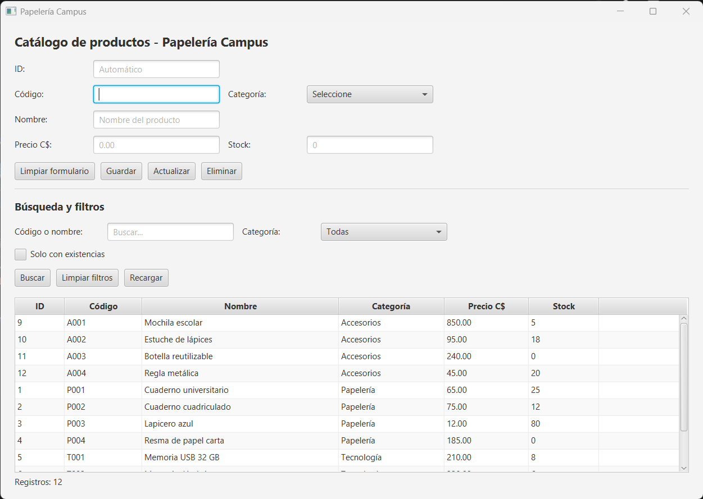

### Filtro combinado (B06 y B07)

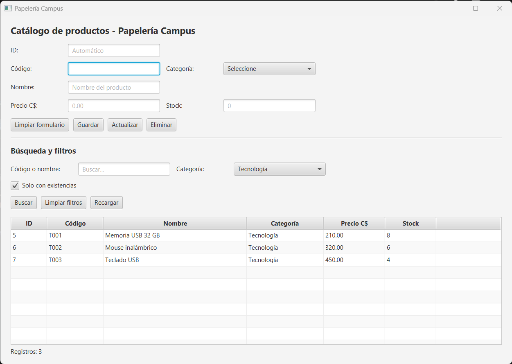

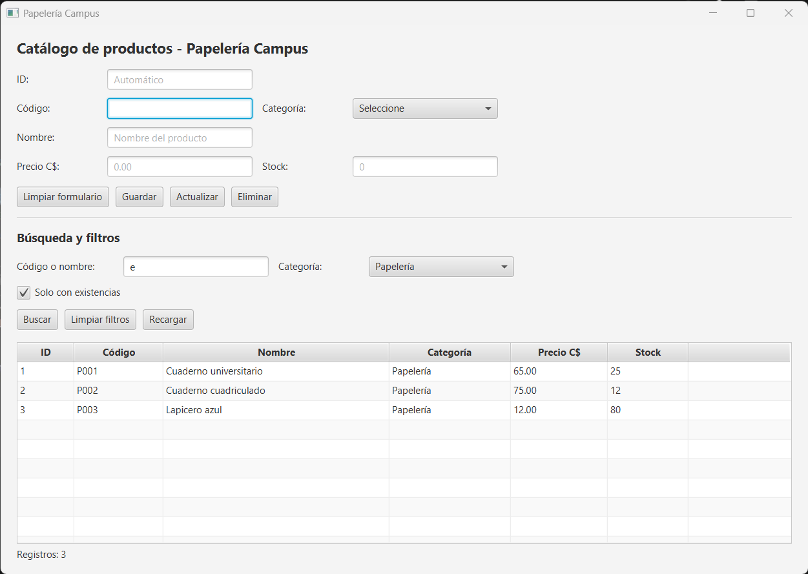

### Validaciones (V01 y V10)

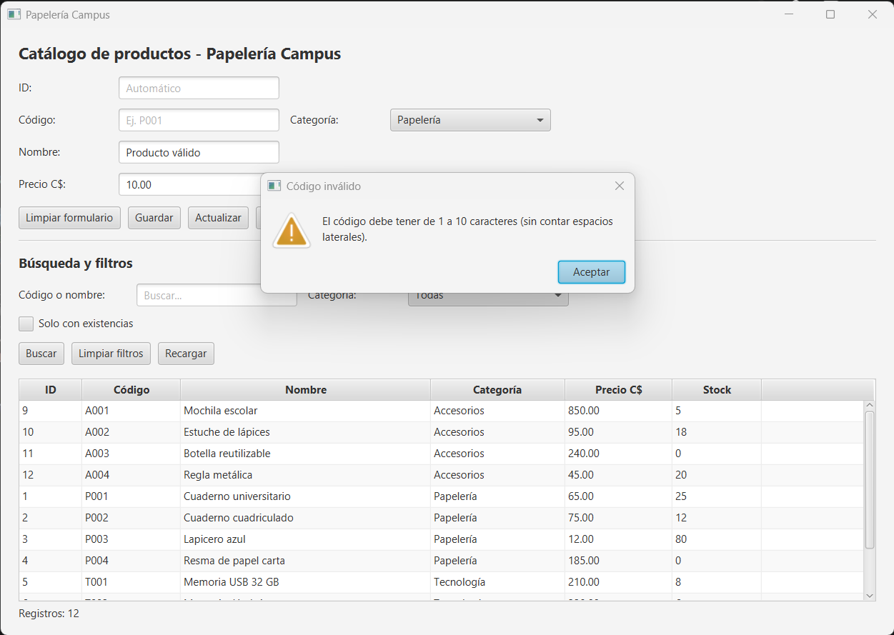

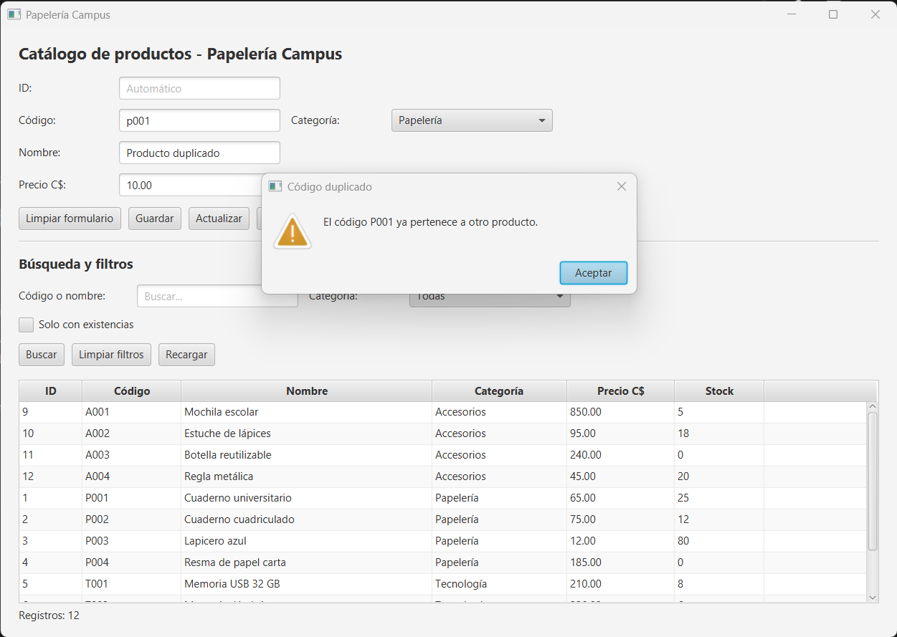

### Ciclo CRUD (C01–C04)

**1. Crear:** formulario con los datos nuevos y confirmación del registro.

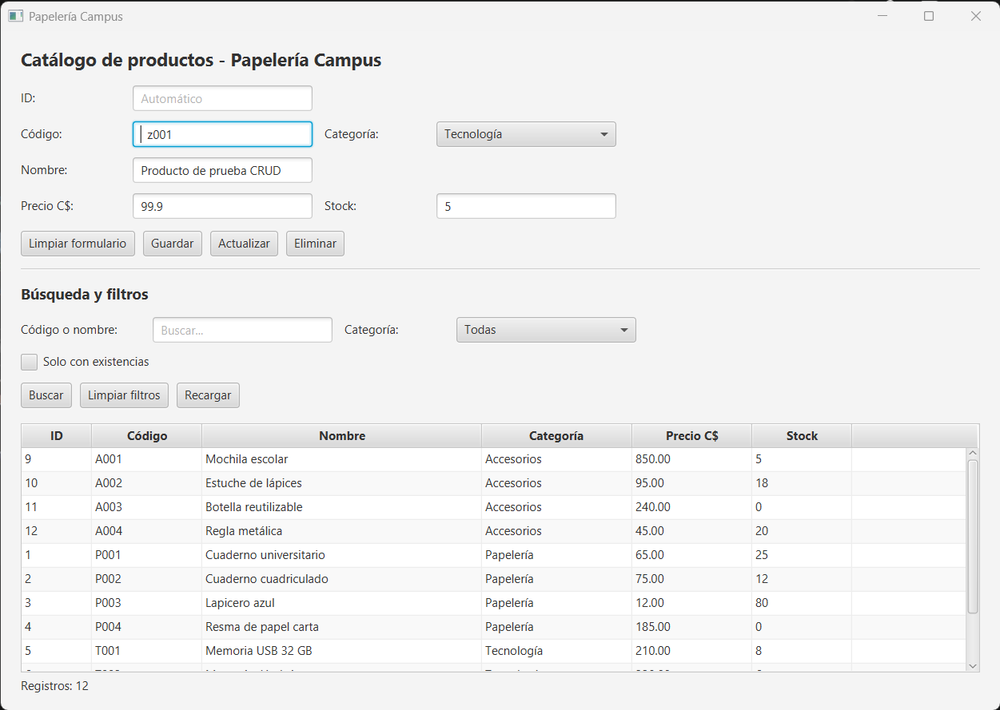
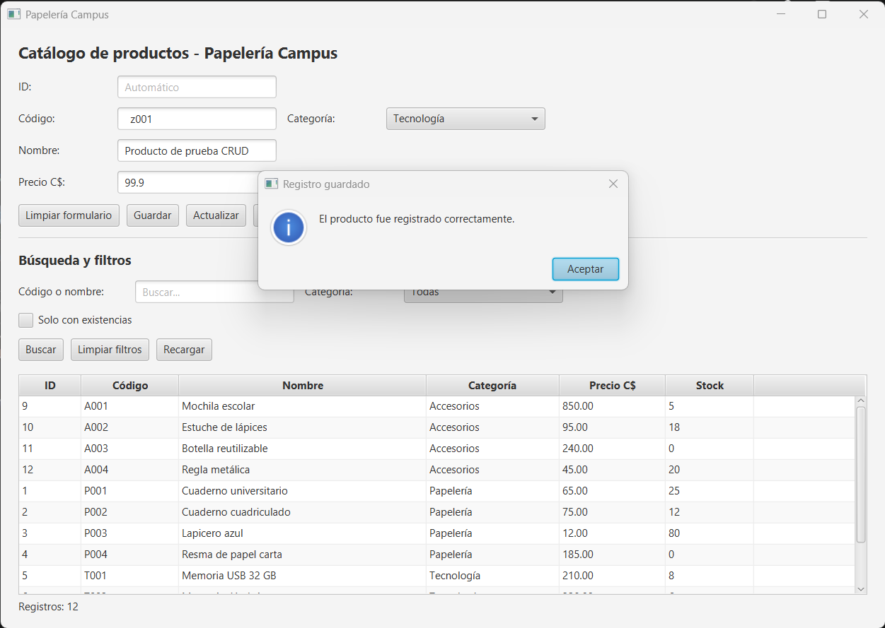

**2. Consultar:** búsqueda del producto creado (el código quedó normalizado como `Z001`).

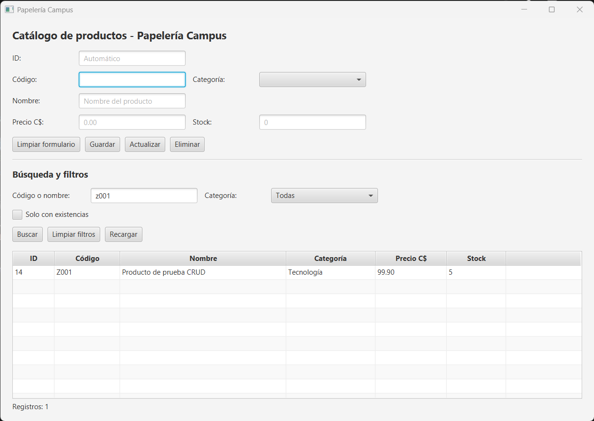

**3. Actualizar:** edición del producto y tabla con los datos nuevos.

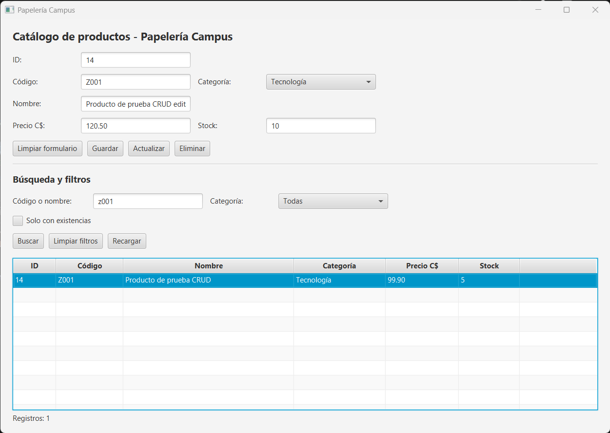
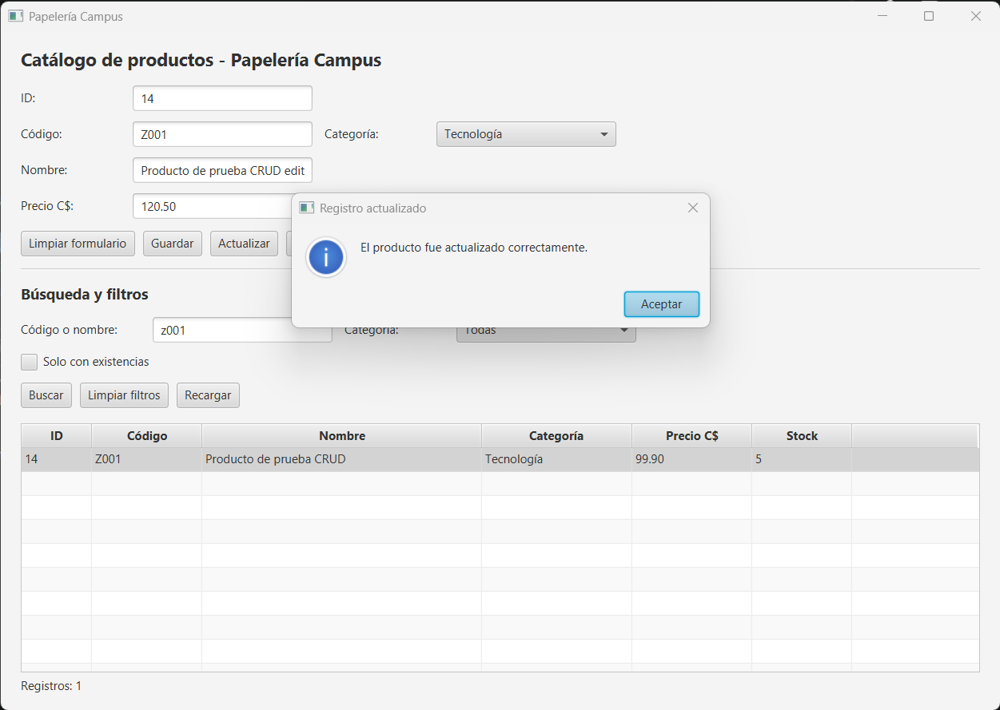
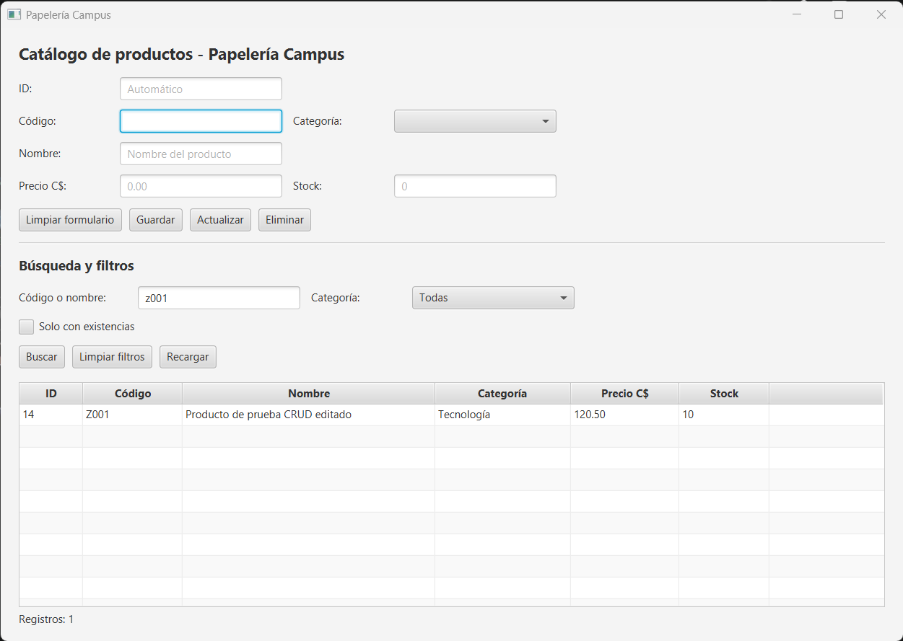

**4. Eliminar:** confirmación, eliminación y listado final con los 12 productos originales.

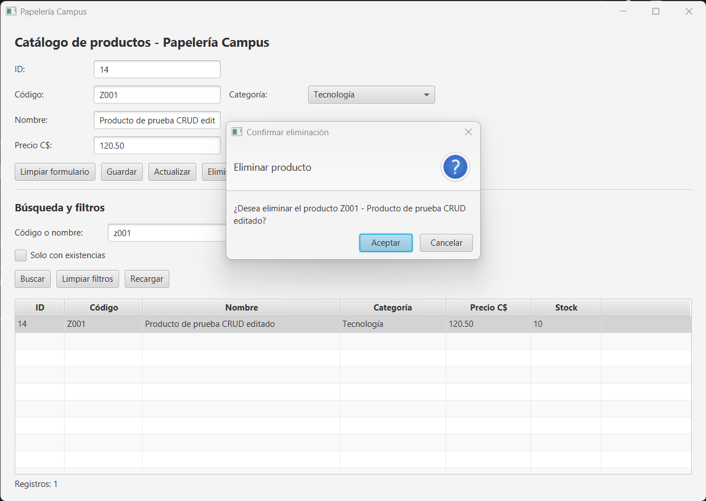
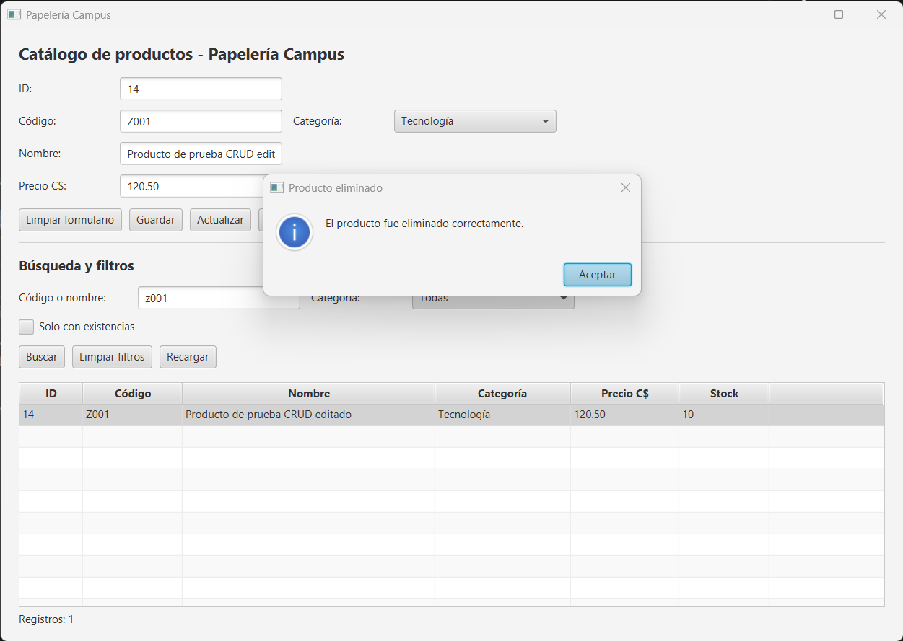
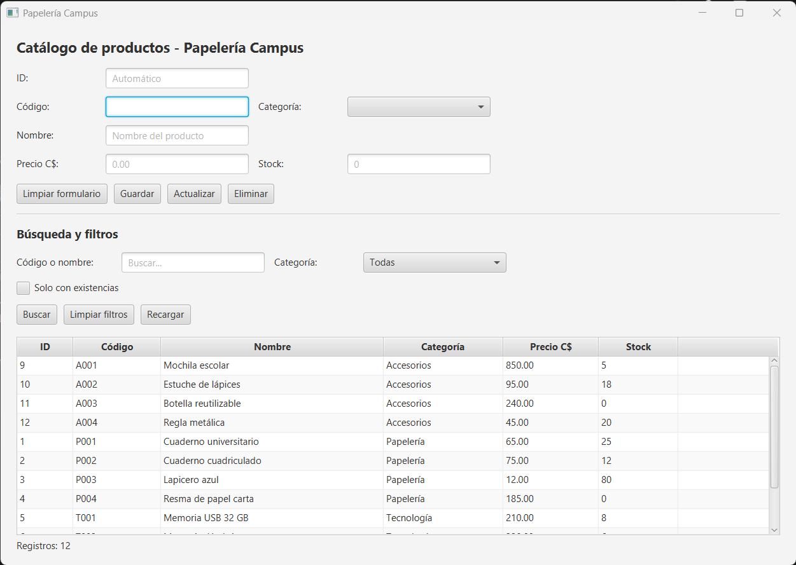

### Restricción CHECK en la base de datos (BD01)

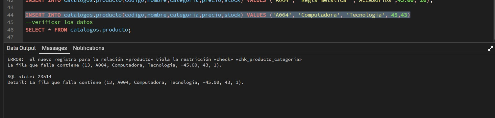
